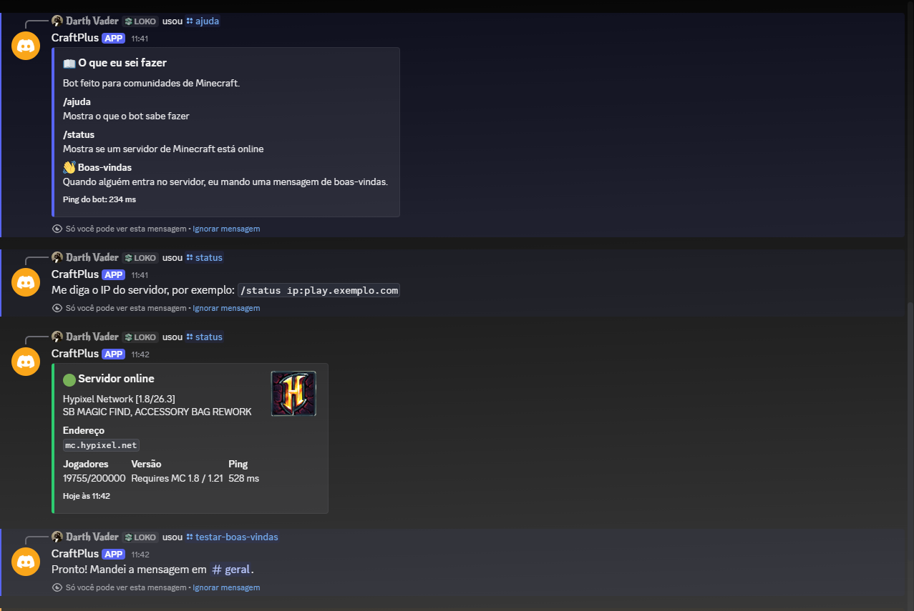
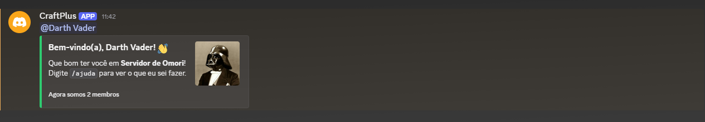

# 🤖 CraftPlus: bot de Minecraft para Discord

Bot para comunidades de Minecraft no Discord: mostra o status do servidor do jogo e dá boas-vindas a quem entra.





## O que ele faz

| Recurso | Como funciona |
|---|---|
| `/status [ip]` | Consulta um servidor de Minecraft (Java Edition) e mostra se está online, jogadores, versão, ping, descrição e ícone do servidor |
| Boas-vindas | Quando alguém entra no Discord, o bot manda uma mensagem com a foto da pessoa e o número de membros |
| `/ajuda` | Lista os comandos do bot (a lista se atualiza sozinha quando um comando novo é criado) |
| `/testar-boas-vindas` | Só para administradores: mostra a mensagem de boas-vindas para conferir como ficou |

Também trata os erros mais comuns com mensagens claras: IP errado, servidor desligado, token inválido e permissões faltando.

## Tecnologias

- [Python 3](https://www.python.org/)
- [discord.py](https://github.com/Rapptz/discord.py): comandos de barra e eventos do Discord
- [mcstatus](https://github.com/py-mine/mcstatus): consulta aos servidores de Minecraft
- [python-dotenv](https://github.com/theskumar/python-dotenv): configurações e token fora do código

## Como rodar

1. Instale o Python 3.10 ou mais novo.
2. Instale as dependências:
   ```
   python -m pip install -r requirements.txt
   ```
3. Copie `.env.example` para `.env` e cole o token do seu bot (Discord Developer Portal → Bot → Reset Token).
4. No Developer Portal, ative **Server Members Intent** (Bot → Privileged Gateway Intents).
5. Ligue o bot:
   ```
   python bot.py
   ```

### Configurações opcionais (`.env`)

| Variável | Para que serve |
|---|---|
| `SERVIDOR_MINECRAFT_PADRAO` | IP usado quando alguém digita `/status` sem informar um |
| `CANAL_BOAS_VINDAS_ID` | Canal das boas-vindas. Se ficar vazio, usa o canal de mensagens do sistema do servidor |

## Estrutura

```
bot.py              → liga o bot, carrega os módulos e trata erros
cogs/geral.py       → /ajuda
cogs/minecraft.py   → /status
cogs/boas_vindas.py → boas-vindas e /testar-boas-vindas
```

---

Feito por **Lukas**. Faço bots de Discord sob medida e resolvo problemas em modpacks de Minecraft. Contato: **1lukas.araujo.freelancer@gmail.com
**
